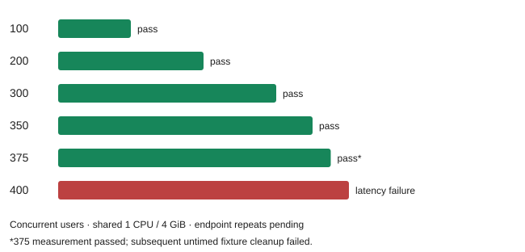

# Convex + PostgreSQL: provisional 375–400-user measurement range

On the M1 Max, the highest passing **measurement** was **375 concurrently active authenticated users**, with **14,811 measured actions, zero failed actions and zero authentication failures**. At **400 users**, the like action's p95 was **819.3ms**, exceeding its **750ms** target; all 15,589 measured actions succeeded.

**The 375-user controller later failed during untimed fixture-cleanup identity preflight.** Its timed workload, full 120-second window, all-user participation, post-run API counts and resource evidence were valid, and owned shutdown was checked. No account had been deleted when preflight failed. **350 users is the highest passing point whose entire controller/API-cleanup lifecycle completed successfully.** Do not present 375 as an entirely successful controller run or a certified maximum.

This is an **observed, provisional measurement transition**, not a confirmed upper limit. Endpoint repeats and soak testing have not been run. Further refinement/confirmation is pending and may change the range.

| Active users | Measurement outcome | Measured actions | Failed actions | Controller lifecycle |
| ---: | --- | ---: | ---: | --- |
| 100 | Pass | 3,974 | 0 | API cleanup and shutdown checked |
| 200 | Pass | 7,983 | 0 | API cleanup and shutdown checked |
| 300 | Pass | 11,981 | 0 | API cleanup and shutdown checked |
| 350 | Pass | 13,929 | 0 | API cleanup and shutdown checked |
| 375 | Pass* | 14,811 | 0 | Failed untimed preflight; shutdown checked |
| 400 | Latency failure | 15,589 | 0 | Used data retained; shutdown checked |

*375: measurement passed; untimed cleanup failed as described above. Original failure and report remain unchanged.

## Deployment and workload

Native ARM64 Linux containers on a 10-core/64-GiB Apple M1 Max with OrbStack. Official Convex backend image/source revision **d1fcbeaf939502a23a0f4b7e9095a12e84866294**, official JavaScript SDK **1.50.0**, native Convex Auth **2.0.0**, PostgreSQL **17.12**. The backend binary reports `local_backend unknown`; its immutable native image digest and OCI source revision identify it, rather than an invented release number. Versions, image digests, original input hashes and report hashes are in [the sanitized evidence](evidence.json).

Convex/Auth and PostgreSQL share one enforced **1 CPU / 4 GiB / no swap** parent cgroup. Both services' CPU/memory/OOM state count toward that total, and each service's identity/health/restarts are checked. This is a container-budget experiment on a larger Mac, not an entire four-GiB machine. No external database/authentication service is excluded from the budget. PostgreSQL retains normal durability settings. Profile: worker pool 16, queries 4/mutations 4 concurrently, V8 actions 2/Node actions 1, MALLOC_ARENA_MAX=2; exact configuration is pinned. Generator: nine CPUs/48 GiB, GC 150/36-GiB soft limit and 480-MiB payload cache.

Every point starts a fresh owned deployment, creates the fixed **15,000-account/150,000-post/150,000-like** recipe through native SDK APIs and verifies the full baseline twice. Post bodies are 1,024 bytes. Setup sessions remain private in RAM and are natively revoked before VUs perform fresh native password logins at five/second. No admin/service credentials enter measured traffic. Official `ConvexHttpClient` HTTP queries/mutations implement the common seven-action social contract, including ownership, private likes, uniqueness, reference checks and real writes. The application phases are 30s ramp/60s warm-up/120s measurement, with 1–5s think time and 300–900s sessions. Final native sign-outs are paced outside the application window. Untimed fixture preparation has no elapsed-time cap; request/resource/host/health guards remain enabled.

Action weights: public feed 35%, own feed 15%, read 15%, create 5%, like 17%, unlike 5%, edit 8%. Targets: p95 reads/lists <=500ms; p95 writes <=750ms; p99 all actions <=2000ms; action failures <1%. Unexpected auth failures disqualify. Action durations include required prerequisite requests. The observed latency targets are evaluated even where a short point has insufficient samples to certify tails.

Dashboard, frontend UI, reactive subscriptions, file storage and other unexercised features are excluded. These figures describe the authenticated HTTP API application on self-hosted Convex, not Convex Cloud or WebSocket subscription capacity.

## Boundary detail

### 350 users

| Action | Measured | Failures | p95 ms | p99 ms |
| --- | ---: | ---: | ---: | ---: |
| listPublic | 4882 | 0 | 35.0 | 60.0 |
| listOwn | 2029 | 0 | 37.0 | 67.7 |
| read | 2092 | 0 | 34.0 | 62.1 |
| create | 716 | 0 | 139.2 | 229.9 |
| like | 2419 | 0 | 244.1 | 397.0 |
| unlike | 705 | 0 | 140.0 | 214.0 |
| edit | 1086 | 0 | 137.2 | 232.5 |

### 375 users

| Action | Measured | Failures | p95 ms | p99 ms |
| --- | ---: | ---: | ---: | ---: |
| listPublic | 5201 | 0 | 56.0 | 86.0 |
| listOwn | 2162 | 0 | 62.0 | 87.4 |
| read | 2220 | 0 | 52.0 | 73.0 |
| create | 756 | 0 | 341.2 | 482.8 |
| like | 2574 | 0 | 486.0 | 646.3 |
| unlike | 740 | 0 | 330.1 | 510.9 |
| edit | 1158 | 0 | 322.1 | 476.4 |

### 400 users

| Action | Measured | Failures | p95 ms | p99 ms |
| --- | ---: | ---: | ---: | ---: |
| listPublic | 5479 | 0 | 64.0 | 92.0 |
| listOwn | 2268 | 0 | 74.0 | 139.3 |
| read | 2341 | 0 | 64.0 | 110.0 |
| create | 797 | 0 | 637.8 | 841.4 |
| like | 2708 | 0 | 819.3 | 1096.6 |
| unlike | 776 | 0 | 668.3 | 941.0 |
| edit | 1220 | 0 | 718.1 | 919.4 |

## Evidence, cleanup and limitations

All users at every published point measured and completed. Raw metrics were replayed to reproduce per-action results and user participation; original report SHA-256 hashes bind the aggregate evidence to those reports. Resource evidence was valid and no measured generator CPU pressure, safety stop or unexpected auth failure occurred. Formal generator headroom remains unverified. Resource peaks cover startup/warm-up/measurement/runner cleanup; they are not measurement-only peaks.

The 375-user error arose during the subsequent native identity lookup used by account-cleanup preflight, after its workload report and `pass` result were written. The controller did not preserve the underlying error message, so its precise cause is unknown. Its stack/failure, used fixture and both data volumes remain local; original evidence is not relabelled. Both services were removed and the parent cgroup verified empty and removed. Continuation requires reviewed measurement evidence and uses fresh deployments; it adds private error capture for any recurrence. Refinement and endpoint repeats remain necessary before a stronger capacity conclusion.

Registration/password login, refresh, native logout revocation, permissions, state changes and cancellation were separately checked with native integration tests. A short test-only token lifetime covered actual expired-token refresh; the capacity profile retains 3,600s access tokens. Measurement-phase password-login/refresh throughput, natural hour-long expiry, soak behavior and sustained capacity are not certified by these points.

Earlier SQLite-backed trials are excluded from this range. Profiling identified eager index-range materialization in the pinned SQLite driver; the supported PostgreSQL driver uses bounded batches instead. Allocator, page-read and CPU-thread diagnostic experiments on copied used data were explicitly ineligible for capacity scoring. See the [deployment profile](../../backends/convex/README.md) for the storage diagnosis and primary-source references. The unchanged seven-action application and resource budget were retained in the PostgreSQL campaign.

Original source snapshots, compressed metrics, private fixtures/credentials and retained volumes stay local and are not published. The original frozen input hashes identify the code used for these observations; later orchestration/private-error-capture changes do not alter timed SDK/application inputs. Shared-host conditions and limited repetition prevent a hardware-independent ratio or universal user-limit claim. Other results: [PocketBase](../pocketbase-v0.42.2/REPORT.md), [Supabase](../supabase-api-2026-11/REPORT.md).
