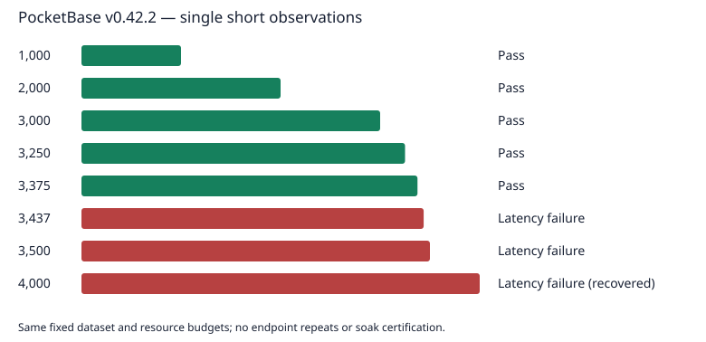

# PocketBase v0.42.2: prepared-session capacity search

On the M1 Max, the highest passing short observation was **3,375 active users**. The first failing point above it was **3,437 users**. This is an observed workload-specific transition interval, not a universal maximum. The user stopped discovery after the final point; endpoint repeats and soak testing were not run.

| Active users | Outcome | Measured actions | Failed actions | Evidence |
| ---: | --- | ---: | ---: | --- |
| 1,000 | Pass | 39,468 | 0 | Original controller report |
| 2,000 | Pass | 78,684 | 0 | Original controller report |
| 3,000 | Pass | 117,990 | 0 | Original controller report |
| 3,250 | Pass | 127,761 | 0 | Original controller report |
| 3,375 | Pass | 132,542 | 0 | Original controller report |
| 3,437 | Latency failure | 130,871 | 0 | Original controller report |
| 3,500 | Latency failure | 135,628 | 0 | Original controller report |
| 4,000 | Latency failure | 134,772 | 210 | Recovered raw measurement |

## Workload and deployment

PocketBase 0.42.2, official JavaScript SDK 0.28.1, native ARM64 Linux containers on a 10-core/64-GiB M1 Max with OrbStack. Backend: one CPU/four GiB, no swap. Generator: nine CPUs/48 GiB, GC150/36-GiB soft limit and 480-MiB deterministic payload cache. The fixed recipe contains 15,000 accounts, 150,000 posts and 150,000 likes. Each point starts from a fresh isolated deployment, seeds through native APIs and verifies the baseline twice. Prepared sessions admit five users/second, then run a 30-second ramp, 60-second warm-up and 120-second measurement with 1–5-second think times.

The action mix is public feed35%, own feed15%, read15%, create5%, like17%, unlike5%, edit8%. Targets: p95 reads/lists<=500ms; p95 writes<=750ms; p99 all actions<=2000ms; action failure rate<1%; unexpected auth failures disqualify. Official SDK request paths, ACLs, ownership, pagination and actual state-changing operations are exercised. Native batching is used only for fixture preparation.

## Boundary observations

- 3,250 users: pass; like p95 486ms, p99 509ms; 0 failed actions. Resource evidence valid; measured generator CPU pressure not observed.
- 3,375 users: pass; like p95 491ms, p99 529ms; 0 failed actions. Resource evidence valid; measured generator CPU pressure not observed.
- 3,437 users: slo_failure; like p95 1748.399999999996ms, p99 4835.679999999999ms; 0 failed actions. Resource evidence valid; measured generator CPU pressure not observed.
- 3,500 users: slo_failure; like p95 620ms, p99 2223ms; 0 failed actions. Resource evidence valid; measured generator CPU pressure not observed.
- 4,000 users: slo_failure; like p95 5680ms, p99 8984.439999999999ms; 210 failed actions. Resource evidence valid; measured generator CPU pressure not observed.

The 4,000-user controller and original campaign terminated after native workload/runner cleanup, before final reporting. Offline replay verified all 4,000 users measured and completed, full timing/action evidence and valid resource evidence; all seven action latency targets failed. Its original reports are not fabricated or relabelled as a completed controller run. This observation is separately marked as recovered.

## Comparison with TrailBase

The separately run TrailBase v0.35.3 benchmark passed 10,000 users twice, varied at 10,300 and failed twice at 10,625 with the same backend/generator budgets and fixed dataset recipe. PocketBase was stopped without endpoint repeats, so its score has weaker repeat evidence. Shared-host conditions were not normalized; do not infer a hardware-independent ratio or sustained-capacity guarantee.

## Evidence and limits

[Sanitized aggregate evidence](evidence.json) contains per-action counts/failures/percentiles and the exact workload/resource settings. Original compressed metrics, source snapshots, private fixtures and retained volumes remain local and are excluded from publication. The backend release is pinned to publisher SHA-256 checksums. The matching PocketBase profile implementation is committed as `4ac400d`; each original runtime manifest binds its exact inputs and generated bundle. The final point completed checked owned shutdown. Native fixtures and dataset credentials are not published.

These short observations do not certify natural token expiry, realtime, file storage, uploads, soak capacity or formal generator headroom. The exact maximum may vary between runs.
