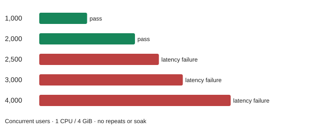

# Supabase required API stack: 2,000-user short-run score

The highest passing observation was **2,000 concurrently active authenticated users**, with **79,049 measured actions and zero failed actions** during a 120-second measurement. All seven action latency targets passed. The user accepted this score and stopped further discovery; no endpoint repeats or soak were run. This is a workload-specific short-run score, not an exact maximum or a claim about Supabase Cloud.

| Active users | Outcome | Measured actions | Failed actions |
| ---: | --- | ---: | ---: |
| 1,000 | Pass | 39,987 | 0 |
| 2,000 | Pass | 79,049 | 0 |
| 2,500 | Latency failure | 85,519 | 40 |
| 3,000 | Latency failure | 88,233 | 0 |
| 4,000 | Latency failure | 86,676 | 2646 |

## Deployment and comparison conditions

Native ARM64 Linux containers on a 10-core/64-GiB M1 Max with OrbStack. Postgres **17.6.1.136**, GoTrue/Auth **2.197.0**, PostgREST **14.18**, Envoy **1.39.6**, official JavaScript SDK **2.119.0**. The coherent upstream configuration is pinned to commit b046f1257110f6ac9c7fefe820bfac3ff88a3f38; exact image digests and runtime input hashes are in [the sanitized evidence](evidence.json).

The four required API services share one enforced **1 CPU / 4 GiB / no swap** parent cgroup. Studio, Realtime, Storage, Functions, Analytics and Pooler are excluded. This exercises the complete seven-action authenticated application API, not the full Supabase product. The one-CPU budget is intentionally constrained relative to the documented full-stack minimum. Generator: nine CPUs/48 GiB, GC150/36-GiB soft limit, 480-MiB payload cache.

Every point uses a fresh owned deployment and a fixed 15,000-account/150,000-post/150,000-like recipe. Fixture data and both complete baseline verifications use native APIs and the official SDK. Optimized setup caches native sessions privately in RAM and revokes them before the VUs perform fresh password logins at five/second. No user tokens or credentials are published. Final native sign-outs are paced at five/second outside the application measurement. Untimed fixture preparation has no elapsed-time cap; request, health, OOM, memory and host guards remain enabled.

The common workload uses a 30-second ramp, 60-second warm-up and 120-second measurement with 1–5-second think times. Action weights: public feed35%, own feed15%, read15%, create5%, like17%, unlike5%, edit8%. Targets: p95 reads/lists <=500ms, p95 writes <=750ms, p99 all actions <=2000ms, action failure rate <1%; unexpected authentication failures disqualify. Native RLS enforces ownership and private likes, indexed stable feeds, foreign keys and duplicate-like constraints.

## Passing point

| Action | Measured | Failures | p95 ms | p99 ms |
| --- | ---: | ---: | ---: | ---: |
| listPublic | 27676 | 0 | 185.0 | 411.0 |
| listOwn | 11779 | 0 | 176.0 | 397.0 |
| read | 12014 | 0 | 174.3 | 382.7 |
| create | 3947 | 0 | 207.7 | 443.5 |
| like | 13461 | 0 | 361.0 | 796.0 |
| unlike | 3862 | 0 | 170.9 | 389.4 |
| edit | 6310 | 0 | 190.0 | 443.0 |

All 2,000 users measured and completed. Resource evidence was valid; no measured generator CPU pressure, backend instability or OOM was observed. Formal generator headroom remains unverified. Password admission succeeded for all 2,000 users before measurement; measurement-phase password login and token refresh were not exercised and are not reported as an authentication-capacity pass.

## Evidence and limits

The first completed failing point above the score was **2,500 users**. Latency failures establish an observed transition, not a repeat-certified limit. Original controller reports, compressed metrics, private source snapshots and retained data volumes remain local. Every published point completed checked owned shutdown. Sanitized per-action and resource evidence includes SHA-256 hashes of the original reports.

Earlier 100/1,000-user workflow checks used a smaller validation dataset and are excluded. An earlier 1,000-user attempt failed because simultaneous final sign-outs overloaded Auth; it is retained as a workflow failure and is not used as a backend application upper bound. The optimized full-dataset 1,000-user point above passed.

TrailBase previously passed 10,000 users twice; PocketBase's highest passing short observation was 3,375. Those results use the same M1 Max container budgets and dataset recipe, but repeat evidence and host conditions differ. See the [PocketBase report](../pocketbase-v0.42.2/REPORT.md) and repository README. These experiments do not establish a hardware-independent ratio, natural-expiry, realtime/storage, sustained capacity or a managed-cloud ranking.
